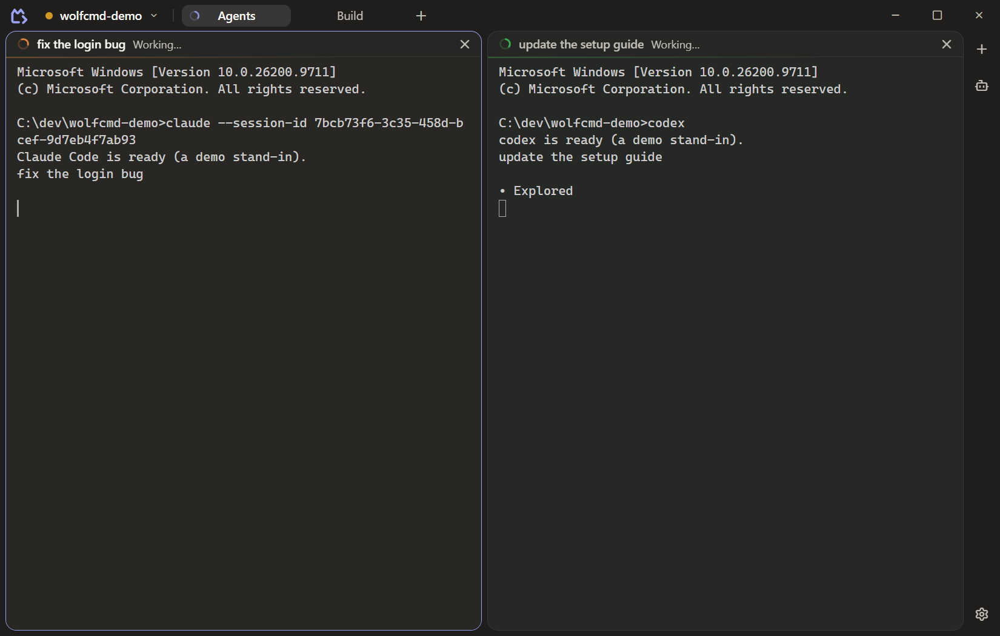
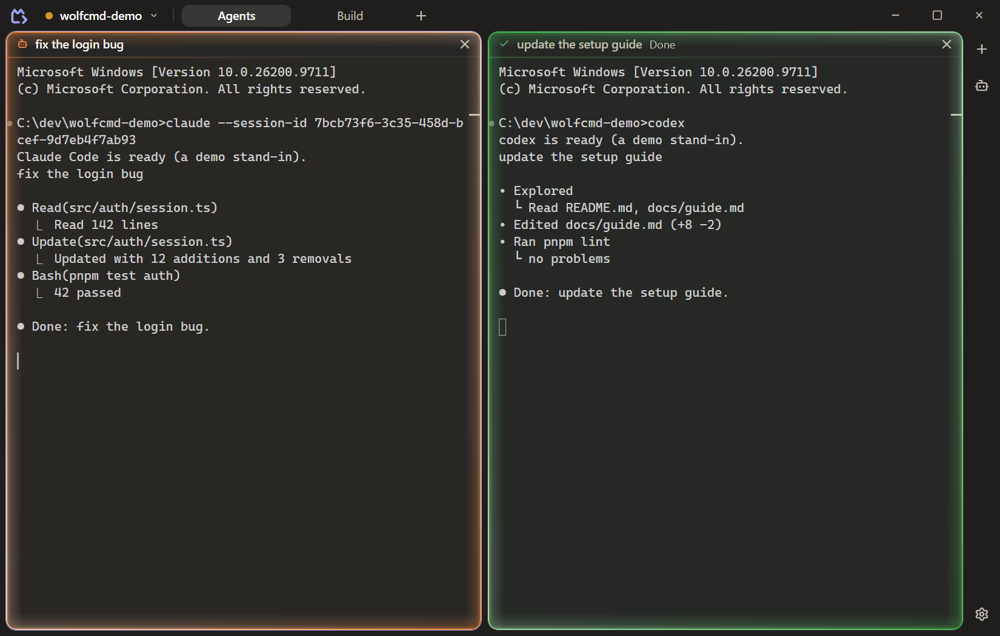
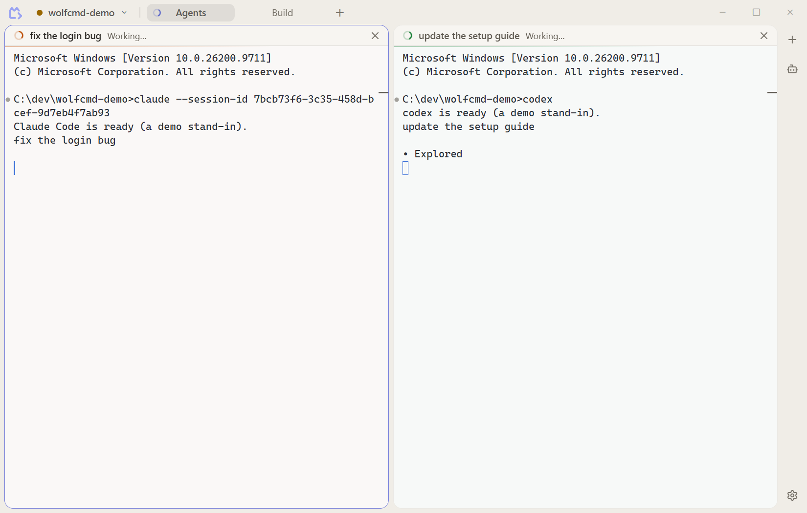
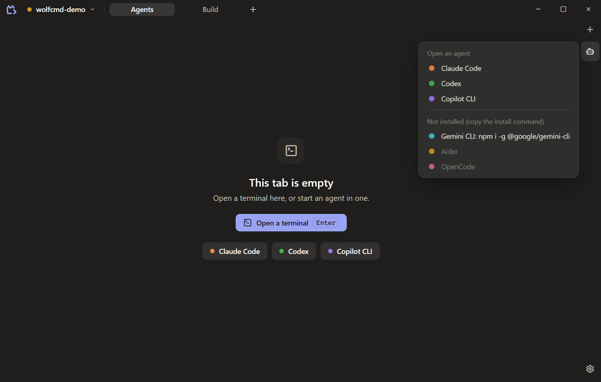

<div align="center">


# WolfCmd

**A fast, calm terminal for Windows, built to be a good home for AI coding agents.**<br>
Workspaces, tabs and tiled terminals. Claude Code, Codex and friends one click away, and their sessions back after a restart.

[](https://github.com/wolfknight949/wolfcmd/releases)


[](LICENSE)

<br>



</div>

---

## Why WolfCmd?

Most of the time you work with one agent in one or two terminals. WolfCmd is made for exactly that: a terminal that opens instantly, stays out of the way, and never loses your work. No extra panels, no suggestions, no agent harness: an agent is a terminal running its own CLI, and WolfCmd only makes it easy to start, find again and resume.

<table>
<tr>
<td width="50%"></td>
<td width="50%"></td>
</tr>
<tr>
<td align="center"><sub>An agent finished while you looked away: its panel glows once in its color</sub></td>
<td align="center"><sub>Dark and light themes</sub></td>
</tr>
</table>

## Features

- **Workspaces and tabs.** A workspace (optionally tied to a folder) holds tabs, shown as pills in the title bar. Switch with a click, Ctrl+Tab or Ctrl+Alt+1…9.
- **Tiled terminals.** Split right or down, resize by dragging, move a panel by dragging its header onto another one, maximize a panel and bring the tiles back. Its shell keeps running through all of it.
- **Agents one click away.** The Agents button lists the agent CLIs you have installed: Claude Code, Codex, Gemini CLI, Copilot CLI, Aider and OpenCode. Choose one and it opens in a new panel in the workspace's folder.
- **Sessions resumed after a restart.** An agent panel picks up its own session where it left off; an agent you ended stays a plain shell.
- **Working and finished indicators.** See which agent is busy on the panel and its tab; a finish you didn't see makes the tab and the panel glow once in the agent's color, and with the window in the background the taskbar flashes and an optional notification names the agent.
- **Git worktrees per workspace.** Work on separate tasks in one repository: create a worktree from the workspace menu, empty or with copies of the main tree's tabs, switch between them and remove them.
- **Undo for layout changes, and no lost agents.** Closed a panel or a tab by mistake? Ctrl+Shift+Z brings it back with its shell or agent still running, screen and all; Ctrl+Shift+Y redoes. Closing a running agent asks first.
- **Crash-safe saving and session restore.** Every change is saved at once; workspaces, splits, folders, window position and scrollback come back after a restart, a crash or a power cut.
- **A good terminal.** ConPTY with PowerShell, Command Prompt, Git Bash and WSL; WebGL rendering; find (case, regex, one command's output); Ctrl+click links to URLs and `file:line:col`; command marks you can jump between; a guard for multi-line pastes; images pasted straight into agents; files dropped from Explorer as quoted paths.
- **Plugins that add agents.** Drop a folder with a small `plugin.toml` into the data folder and your own agent CLI shows up in the Agents menu ([guide](docs/guides/plugins.md)). Plugins declare data only; WolfCmd never runs plugin code.
- **Close to tray.** Closing the window keeps terminals and agents running in the tray; Ctrl+Q quits.
- **Dark and light themes**, or follow the system. A calm, warm look that is the same everywhere.

<p align="center"></p>

More in the [user guide](docs/user-guide.md).

## Install

With [winget](https://learn.microsoft.com/windows/package-manager/winget/):

```powershell
winget install Wolfknight949.WolfCmd.Beta
```

Or download the installer (`WolfCmd_<version>_x64-setup.exe`) from [Releases](https://github.com/wolfknight949/wolfcmd/releases) and run it. It installs for your user only, no admin rights needed. Update with `winget upgrade Wolfknight949.WolfCmd.Beta`; the app never updates or checks for updates by itself.

### Code signing

Free code signing provided by [SignPath.io](https://about.signpath.io), certificate by [SignPath Foundation](https://signpath.org). Signed installers are built from this repository by GitHub Actions; see the [code signing policy](CODE_SIGNING_POLICY.md). Until signing is in place, the installer is unsigned and Windows SmartScreen may warn on first run: choose **More info → Run anyway**.

WolfCmd needs Windows 10 or 11 with the Microsoft Edge WebView2 runtime (part of Windows 11 and current Windows 10).

## Keyboard shortcuts

| Keys | Does |
|---|---|
| Ctrl+Shift+T | New tab |
| Ctrl+Shift+D | Duplicate the tab |
| Ctrl+Tab / Ctrl+Shift+Tab | Next / previous tab |
| Ctrl+Alt+1…9 | Go to tab 1…9 |
| Alt+Shift+= / Alt+Shift+- | Split right / split down |
| Alt+Arrow keys | Move the focus to the neighbouring panel |
| Ctrl+Shift+Enter | Maximize the panel / show the tiles again |
| Ctrl+Shift+W | Close the panel (a running agent asks first) |
| Ctrl+Shift+Z / Ctrl+Shift+Y | Undo / redo a layout or workspace change (closing, splitting, moving, renaming…) |
| Ctrl+Shift+N | New workspace |
| Ctrl+Shift+F | Find in the terminal |
| Ctrl+Up / Ctrl+Down | Jump to the previous / next command |
| Ctrl+Shift+C, Ctrl+V | Copy, paste (a right-click copies a selection or pastes) |
| Ctrl+Shift+A / Ctrl+Shift+K | Select all / clear the terminal |
| Ctrl+= / Ctrl+- | Font size |
| Ctrl+, | Settings |
| Shift+F10 or the Menu key | The focused item's menu (Shift+right-click in a terminal) |
| Ctrl+Q | Quit (closing the window keeps WolfCmd in the tray) |

## Build from source

Prerequisites:
- **Rust** at the version in [`rust-toolchain.toml`](rust-toolchain.toml) (rustup installs it on the first build), with the MSVC build tools (Visual Studio Build Tools, "Desktop development with C++").
- **Node.js** at the version in `package.json`'s `engines` (22.x) and **pnpm** (the version in `packageManager`; `corepack enable` sets it up).
- The **WebView2 runtime** (already on Windows 11).

```powershell
pnpm install     # JS dependencies
pnpm dev         # run with hot reload (its own data folder, %APPDATA%\WolfCmd-dev)
pnpm build       # release build and the NSIS installer
pnpm check       # build, format check, lint, typecheck, knip and all unit tests
pnpm e2e         # end-to-end tests that drive the real app (Windows, opens windows)
```

How the code fits together: [docs/ARCHITECTURE.md](docs/ARCHITECTURE.md). All the docs: [docs/README.md](docs/README.md).

## Privacy

WolfCmd sends nothing anywhere without your action: no telemetry, no update checks, no accounts. Agents are started only when you open them (or when you restore a panel that was running one), and Ctrl+click opens web addresses only when you click them. Your workspaces and settings stay in `%APPDATA%\WolfCmd`. Details: [PRIVACY.md](PRIVACY.md).

## Contributing

Bug reports, ideas and pull requests are welcome. See [CONTRIBUTING.md](CONTRIBUTING.md) for how to build, test and send a change, and [SECURITY.md](SECURITY.md) to report a vulnerability privately.

## Licence

[MIT](LICENSE) © 2026 Volodymyr Ivanets
